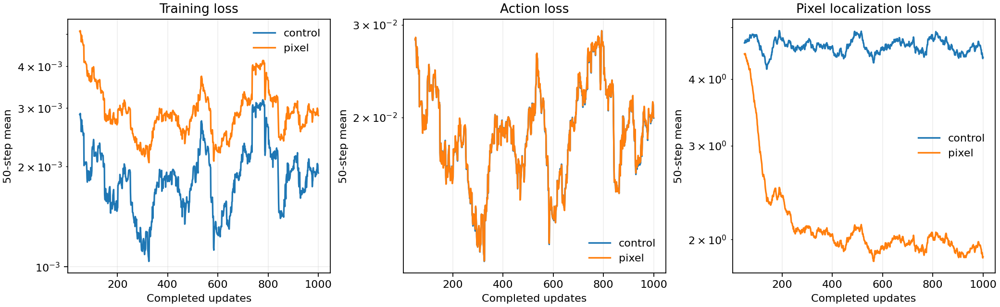
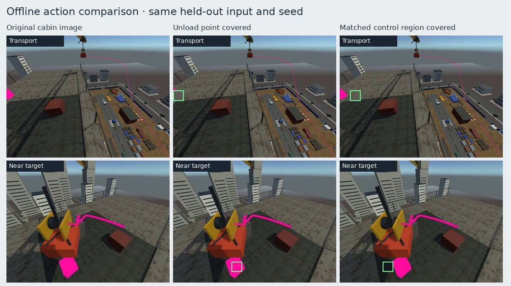

# CraneVLA — Demonstration Data & Learning-Control Experiments

A visual showcase of a simulated crane project connecting PICO demonstrations, LeRobot data and RLinf/OpenPI policy adaptation. 本仓库展示塔吊仿真项目的既有训练与诊断结果，仅包含文档、图表和对应标量数据，不包含完整源码、训练权重或原始示教数据。

## Project scope

The project uses physical-time validation, 10 Hz resampling, six-dimensional joint states and 16-step three-axis action windows. The artifacts below illustrate paired training and offline diagnosis. They do not establish physical-crane deployment, closed-loop improvement or generalization.

## Paired training

Historical training curves use 50-step moving means and logarithmic y axes. The auxiliary pixel-localization loss decreases; this does not by itself demonstrate improved closed-loop success. Total objectives differ between the arms, so their raw total-loss values should not be used as a model ranking.

历史配对训练：像素定位损失下降不等于闭环成功率提高；总损失包含项不同，不能据此给模型排名。

## Offline occlusion diagnosis

The original cabin view is compared with a covered unloading point and a matched control region. These are intervention examples from transport and near-target phases, not demonstrations of autonomous task success.

原始图像、卸货点遮挡和匹配区域遮挡用于离线诊断；示例图不能单独证明因果结论或自主搬运成功。

[Figure context and source data / 图注与源数据](docs/visual-results.md) · [Asset provenance / 素材来源](docs/media/manifest.json)

## Contribution and attribution

I proposed the project concept and independently developed the custom software, algorithm adaptation and experiment workflows. A collaborator created the base Unity model from my concept. RLinf/OpenPI, Unity/PICO and other upstream tools retain their respective attribution.

本人提供项目思路并独立完成自有软件、算法适配及实验开发；基础Unity建模由协作者完成。上游模型、框架、工具和基础资产不计为个人原创。

## Reproducibility boundary

The included CSV files are archived training scalar records. The images are byte-for-byte copies of existing results, with SHA-256 recorded in the manifest. Source paths in the manifest refer to the preparation workspace, not downloadable files in this repository. Full simulation/training reproduction requires unpublished code, configurations, datasets and model artifacts. No new experimental run was performed for this showcase.
