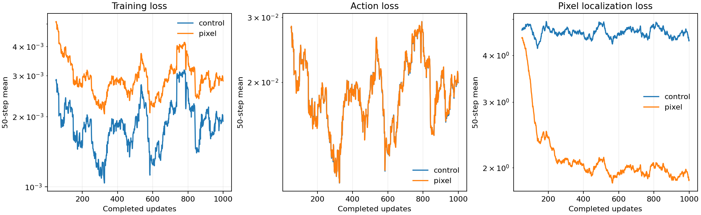
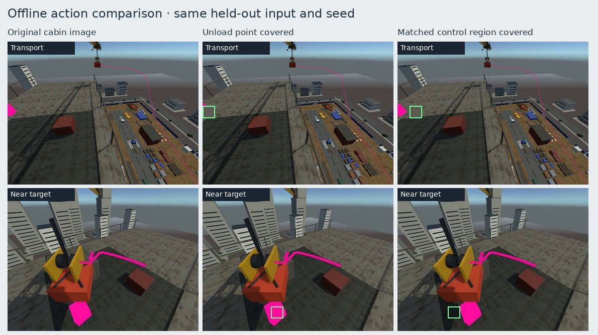

# Visual results · 可视化结果

Existing local artifacts from CraneVLA training and diagnosis. These are historical results, not a new experiment. The base Unity model was created by a collaborator from the project owner's concept; the custom software, algorithm adaptation and experiment work were independently completed by the project owner. RLinf/OpenPI and device SDKs retain upstream attribution.

## Paired training: control and pixel supervision

配对训练的总损失、动作损失与像素定位损失。横轴为完成的更新次数；曲线采用50步滑动均值，纵轴为对数刻度。蓝色为control，橙色为pixel辅助监督；两组总损失的目标包含项不同，不能只比较总损失数值给模型排名。

图中像素辅助组的定位损失下降，但动作损失曲线接近。该图用于说明训练行为与对照设计，**不直接证明闭环成功率、泛化能力或真机控制效果提高**。本轮仅检查已存图像、CSV与绘图逻辑，未重跑训练或访问远端权重。

Source scalars: [control](media/control-training-history.csv) · [pixel](media/pixel-training-history.csv)。对应归档脚本为原评测目录 `pixel-supervision/archive.py::archive_curve`。

## Offline occlusion intervention

同一输入与随机种子下比较原始驾驶室图像、卸货点遮挡、匹配对照区域遮挡；两行分别展示运输阶段和接近目标阶段。图片说明离线诊断的干预方法；仅有这张示例图不能证明动作因果归因或实际搬运成功。绿色框是干预区域标记，不是机器人预测输出。

对应原评测目录为 `cabin-action-ablation/`，完整统计涉及逐窗口、分组及排除条件；不能将示例帧数量当成独立实验样本数。

本仓库仅发布展示材料，未包含完整训练、仿真或采集代码；[素材来源与校验值](media/manifest.json)保留原始位置。未打包模型权重、服务器日志、原始示教数据或协作者的基础工程。
